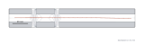
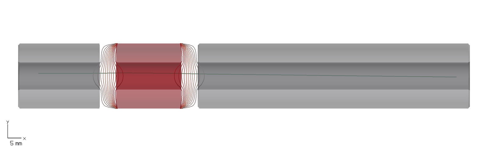

# Your first einzel lens

This tutorial takes about twenty minutes. It is for someone who designs mass
spectrometer ion optics, has used SIMION, and wants to see how the same job goes
in Einzel. You do not need to know C#, and you do not need an AI agent. You need
the `einzel` executable on your `PATH` and a terminal.

You will:

1. create a project and start from the shipped einzel lens,
2. read what the model declares, validate it, and estimate its cost,
3. solve the field and read the convergence report,
4. fly an ion and read the answer, its uncertainty and its warnings,
5. draw the lens,
6. measure the focus, change the centre voltage and watch the focus move,
7. scan the voltage with a study file,
8. pin a result with a test, and write a report.

Every command below was run, in this order, on the 26.1.0 Release build. The
output excerpts are copied from that session. Where lines are left out you will
see `...`; long paths are shortened the same way. Your timings will differ.

If you know SIMION, keep [Coming from SIMION](coming-from-simion.md) open in
another tab. It maps potential arrays, Fly'm, user programs and the rest onto
what you will meet here.

## 1. Create a project

A project is a folder. There is no session and no database: models, studies and
tests are small JSON files you can read, diff and keep in git.

```
$ einzel init lens-tutorial
Created project at ...\lens-tutorial
  models/
  extensions/
  studies/
  figures/
  results/
  tests/
  .einzel/
  models\reflectron.json
  tests\reflectron.json
  AGENTS.md

Next: einzel run models/reflectron.json --vtu
```

`init` scaffolds a reflectron model and a test for it, so the project works from
the first minute. Leave them alone and add a lens.

```
$ cd lens-tutorial
```

`results/` holds answers and the manifests that say how each was computed.
`.einzel/` holds large regenerable files such as trajectories. You can delete
`.einzel/` at any time.

## 2. Start from the einzel lens template

`einzel templates` lists the shipped device templates. Each one is a model file,
not code.

```
$ einzel templates
...
einzel-lens
    Three coaxial tubes in a row, the outer two grounded and the middle one held at a voltage: the...
...
```

Copy it into the project:

```
$ einzel new models/einzel-lens.json --from-template einzel-lens
wrote ...\lens-tutorial\models\einzel-lens.json from template:einzel-lens
```

`new` will not overwrite a model that already exists. Delete the file first or
choose another name.

Open `models/einzel-lens.json` in an editor. It is worth reading once. Three
things are different from a SIMION workflow:

- **Every number has a unit.** `{"value": 500, "unit": "V"}`, never a bare `500`.
  A bare number is a validation error on purpose.
- **Geometry is declared, not drawn.** The three tubes are three `rectangle`
  electrodes in a half-plane, and `"symmetry": "cylindrical"` turns each rectangle
  into a ring. This is the equivalent of a cylindrically symmetric potential array.
- **Dimensions are parameters.** Electrode edges are expressions such as
  `"centreStart"` or `"boreRadius + wallThickness"`, so changing one length moves
  everything that depends on it. There is no separate refine step to forget: every
  run solves the field from the model as it stands.

## 3. See what the model declares

`einzel outline` lists the parameters with their units and bounds, and the derived
ones with the expressions that define them.

```
$ einzel outline models/einzel-lens.json
einzel-lens  schema 0.3
  boreRadius           5                                mm        0.5 to 50 mm
  entranceLength       30                               mm        2 to 200 mm
  centreLength         24                               mm        1 to 200 mm
  gap                  6                                mm        0.2 to 50 mm
  driftLength          100                              mm        5 to 1000 mm
  wallThickness        7                                mm        0.5 to 100 mm
  centrePotential      500                              V         -20000 to 20000 V
  beamEnergy           1000                             V         1 to 100000 V
  launchRadius         1                                mm        0 to 40 mm
  cellsPerRadius       24                               1         4 to 128 1
  outerRadius          boreRadius + wallThickness       mm        (derived)
  centreStart          entranceLength + gap             mm        (derived)
  centreEnd            centreStart + centreLength       mm        (derived)
  exitStart            centreEnd + gap                  mm        (derived)
  totalLength          exitStart + driftLength          mm        (derived)
  launchX              entranceLength / 4               mm        (derived)
  detectorX            totalLength - boreRadius         mm        (derived)
  cellSize             boreRadius / cellsPerRadius      mm        (derived)
```

So the lens has a 5 mm bore and a 24 mm centre tube at 500 V between two grounded
tubes, with 6 mm gaps. A 1 keV ion of m/z 500 (set in the file's `ion` block) is
launched 1 mm off axis and parallel to it. The unit `1` means dimensionless.

The mesh is a parameter too: `cellsPerRadius` sets the cell size as a fraction of
the bore. You will use it in step 9 to check that the answer does not depend on
the mesh.

## 4. Validate

```
$ einzel validate models/einzel-lens.json
OK  ...\lens-tutorial\models\einzel-lens.json
    schema 0.3, sha256:c0a941c293a9fd4bf6244cfce714eefb2bb8eb62051c928143e523e168359c7e
```

Validation checks units, bounds and expressions, and whether the requested physics
is valid in the declared regime. The hash identifies this exact text of the model;
every result is tied to it.

## 5. Estimate the cost

Before anything expensive, ask what it will cost:

```
$ einzel estimate models/einzel-lens.json
field 0  Solved2D       1025x65          0.87 s      9.1 MiB
total         1 s, peak 9.1 MiB

basis: Plane solves: 13 s per million nodes, the documented rate: a pilot solve of 16,929 nodes took 13 ms, too little to time. ... The mesh is 0.162 x 0.188 mm against a requested 0.208 mm, because each axis rounds its interval count up to a power of two - finer than asked for on every axis, never coarser ...
```

The `basis:` paragraph explains where each number came from. Two things in it
matter for every model you build:

- The grid is **1025 by 65 nodes**, finer than the requested 0.208 mm. Each axis
  rounds its interval count up to a power of two. Cost therefore changes in steps
  as you change the cell size, and the estimate tells you where the next step is.
- For a model this small the estimate is pessimistic: the solve really takes a
  quarter of a second (next step). On large models the solve rate is measured on
  your machine and the estimate is much closer.

## 6. Solve the field

`einzel solve` solves the potential and reports how the solve went, without flying
anything. This is the step that replaces SIMION's Refine.

```
$ einzel solve models/einzel-lens.json
field 0  1025x65 at 0.1621 x 0.1875 mm (stretched)
          3 electrode(s), 36266 fixed node(s), 1097 cut link(s)
          9 cycles at factor 0.0412, residual 3.43E-013 of initial
          5 coarse level(s), 720 sweep(s), coarsest 99 node(s)
          peak |phi| 500 V
solved in 271 ms
  [Qualified] mesh.node-on-shared-face: field element 0 (solved2d): 148 mesh nodes on a grounded face of the solve domain lie on the surface of a conductor that holds something other than zero volts - for example the node at (36.1503906, 12) mm, where 'centre' meets the grounded top edge. ... Carry the conductor past the grounded face, so every node on the face is inside the conductor by any arithmetic, or stop it a fraction of a cell short, and keep any face that crosses the boundary off a line of nodes; ...
```

How to read the report:

- **`(stretched)`**: the cells are not square (0.162 by 0.188 mm). That is normal.
  The worst allowed ratio is two to one.
- **`1097 cut link(s)`**: places where an electrode surface falls *between* nodes.
  Einzel does not snap surfaces to the grid. Each cut link stores how far across
  the cell the surface lies, so curved and off-grid surfaces converge at second
  order instead of as a staircase.
- **`9 cycles at factor 0.0412, residual 3.43E-013 of initial`**: the multigrid
  solver needed 9 cycles, each cutting the error to about 4% of what it was. The
  default stopping point is a residual of 1e-12 of the initial one. A factor near
  1 would mean the solver is struggling.
- **`peak |phi| 500 V`**: no potential exceeds the largest applied one. A higher
  peak would mean the solve had diverged.

### The warning, and what to do about it

Every warning has a severity. `Qualified` means the number is usable but carries a
caveat you should know about. Warnings cannot be switched off; they travel with
every number, file and figure the run produces.

This one says that the outer face of the centre tube lies exactly on the grounded
edge of the solve domain. The domain edge is itself a 0 V electrode, so 148 nodes
are claimed by both a 500 V conductor and a 0 V boundary, and which one wins is
decided by the last bit of floating-point arithmetic. Refining the mesh cannot
detect this, because a power-of-two mesh puts the same face on a node at every
refinement.

The fix it suggests is to carry the conductor past the edge. Open
`models/einzel-lens.json` and find the `centre` electrode. Change its `maxY` from

```json
"maxY": { "expression": "outerRadius", "unit": "mm" },
```

to

```json
"maxY": { "expression": "outerRadius + wallThickness", "unit": "mm" },
```

Only the centre tube needs it, because the other two are at 0 V and agree with the
grounded edge. Solve again:

```
$ einzel solve models/einzel-lens.json
field 0  1025x65 at 0.1621 x 0.1875 mm (stretched)
          3 electrode(s), 36266 fixed node(s), 1097 cut link(s)
          9 cycles at factor 0.0412, residual 3.43E-013 of initial
          5 coarse level(s), 720 sweep(s), coarsest 99 node(s)
          peak |phi| 500 V
solved in 264 ms
```

The warning is gone. In this lens it was harmless: the flight time in the next
step is the same to every printed digit with and without the change, because the
affected nodes are far from the beam. In a mirror whose end cap lies in the
boundary it is not harmless, which is why it is reported every time.

## 7. Fly an ion

```
$ einzel run models/einzel-lens.json --vtu
  solving the field, which for a large geometry is the longest single step of a run
  the field is solved in 0.3 s; stepping now
flight time   8.394351 +/- 1.49E-08 us
              convergence in integrator tolerance, observed order 0.897 of 1
energy drift  1.87E-009 relative (ACC-4 budget 1e-6)
steps         3257, 0.0000 m advanced analytically
final x       161.000000 mm
engine        26.1.0+6ed90fd2f4578e17bbcb4eed4afa8dfba028c1e6, model sha256:8a298b2...

wrote results\einzel-lens.manifest.json
wrote .einzel\einzel-lens.trajectory.vtu
wrote results\einzel-lens.result.json
```

Each run solves its field, then integrates the trajectory with an adaptive
Dormand-Prince 5(4) integrator until the ion crosses the detector plane. It lands
on that plane exactly, not at the end of whichever step passed it.

- **`flight time 8.394351 +/- 1.49E-08 us`**. Results come with an interval and
  say where the interval came from. Here it is
  `convergence in integrator tolerance`: the flight was repeated at three
  integrator tolerances, and the interval is how much the answer moved. **It does
  not include the error from the mesh.** You check that separately by refining the
  mesh, which you will do in step 9.
- **`energy drift 1.87E-009`**: total energy is conserved to two parts in a
  billion, against a budget of one part in a million. This is your
  trajectory-quality check.
- **`final x 161.000000 mm`**: the detector plane near the end of the exit tube.

The terminal shows only the axial coordinate of where the ion ended. To see the
radial one, ask for JSON (`--json`) or open `results/einzel-lens.result.json`:

```
$ einzel run models/einzel-lens.json --json
...
  "finalPositionMm": [
    161,
    -0.3856717070564825,
    0
  ],
...
```

The ion started at +1 mm and arrived at -0.39 mm, so it crossed the axis somewhere
inside the exit tube. Step 9 measures where.

`--vtu` wrote the trajectory to `.einzel/einzel-lens.trajectory.vtu`, which opens
in ParaView. `results/einzel-lens.manifest.json` records the model hash, engine
version, solver version and machine, so the run can be regenerated and checked
later. Running the same model again overwrites both files.

## 8. Draw it

A vector section through the instrument, with equipotentials and the trajectory:

```
$ einzel render section models/einzel-lens.json
wrote ...\lens-tutorial\figures\einzel-lens.section.svg
160 by 49 mm, 34 paths, 2 labels
decimated to 0.14 mm; trajectory 805 points to 3
```



The trajectory is simplified for drawing, but never by more than the tolerance
printed on the figure (0.14 mm here). The ray bends by about a millimetre over
160 mm, so three points draw it within that tolerance. Text stays text, so you can
relabel the SVG, or a PDF (`--format pdf`), in a drawing program. A warning on the
model goes onto the figure too: drawn before the fix in step 6, the same section
carried a hatched band and a `QUALIFIED: mesh.node-on-shared-face` line.

A picture of the same scene as the 3-D viewport shows it:

```
$ einzel render still models/einzel-lens.json --view side --see-through --height-px 500
wrote ...\lens-tutorial\figures\einzel-lens.still.png
1600 by 500 px, side view, conductors translucent; 3 electrodes, 12 equipotential levels, 1 trajectories, 0 density contours; ruler arms 5 mm along x, y, lower left
```



Without `--see-through` the tubes are opaque and hide the ion. `--view` also takes
`iso`, `top` and `front`. Both commands write to `figures/`.

## 9. Measure the focus, then move it

The shipped model stops the ion near the end of the exit tube. To read the focal
point directly, make a second model whose detector is the axis itself, so the
flight ends where the ray crosses it.

```
$ einzel new models/lens-focus.json --from-template einzel-lens
wrote ...\lens-tutorial\models\lens-focus.json from template:einzel-lens
```

Make two edits in `models/lens-focus.json`. First, the same `maxY` change to the
`centre` electrode as in step 6. Second, replace the detector

```json
"detector": {
  "planePoint": { "expression": ["detectorX", "0", "0"], "unit": "mm" },
  "normal": { "value": [-1, 0, 0] }
},
```

with a plane through the axis:

```json
"detector": {
  "planePoint": { "value": [0, 0, 0], "unit": "mm" },
  "normal": { "value": [0, 1, 0] }
},
```

A detector's normal points back toward where the ion comes from (here it starts at
y = +1 mm), and the flight ends when the ion crosses to the other side.

```
$ einzel run models/lens-focus.json
  solving the field, which for a large geometry is the longest single step of a run
  the field is solved in 0.3 s; stepping now
flight time   6.771252 +/- 2.94E-08 us
              convergence in integrator tolerance, observed order 0.833 of 1
energy drift  1.87E-009 relative (ACC-4 budget 1e-6)
steps         3208, 0.0000 m advanced analytically
final x       129.115873 mm
...
```

The ray crosses the axis at **129.1 mm**. The lens midplane is at
30 + 6 + 24/2 = 48 mm, so the focal length is about 81 mm, roughly sixteen bore
radii.

Now raise the centre electrode to 600 V. You can edit the file, or use
`outline --set`, which takes the value in the parameter's own declared unit (write
`600`, not `600 V`):

```
$ einzel outline models/lens-focus.json --set centrePotential=600
set centrePotential to 600
wrote models/lens-focus.json
einzel-lens  schema 0.3
...
  centrePotential      600                              V         -20000 to 20000 V
...
```

Two things to know about `--set`. A value outside the declared bounds is still
written, and then reported as `VALUE_OUT_OF_BOUNDS` with exit code 1, so check the
output (`--dry-run` shows what would be written but does not check the bounds).
And it rewrites the whole file in a standard layout: one property per line, and
apostrophes in descriptions written as `'`. If you keep models in git, expect
a large diff the first time.

```
$ einzel run models/lens-focus.json
...
flight time   5.341109 +/- 1.05E-08 us
              convergence in integrator tolerance, observed order 1.05 of 1
energy drift  2.72E-009 relative (ACC-4 budget 1e-6)
steps         3312, 0.0000 m advanced analytically
final x       96.844457 mm
...
```

The focus moved upstream to **96.8 mm**: a stronger centre voltage gives a shorter
focal length, now about 49 mm from the midplane.

### Is the mesh fine enough?

The interval on the flight time covers the integrator, not the mesh. To check the
mesh, double the resolution and compare:

```
$ einzel outline models/lens-focus.json --set cellsPerRadius=48
set cellsPerRadius to 48
wrote models/lens-focus.json
...
$ einzel run models/lens-focus.json
  solving the field, which for a large geometry is the longest single step of a run
  the field is solved in 0.5 s; stepping now
flight time   5.342176 +/- 2.24E-09 us
              convergence in integrator tolerance, observed order 1.84 of 1
energy drift  5.18E-009 relative (ACC-4 budget 1e-6)
steps         4815, 0.0000 m advanced analytically
final x       96.866176 mm
...
```

Doubling the mesh moved the focus by 0.02 mm and the flight time by about 1 ns,
two parts in ten thousand. That is far larger than the printed integrator
interval, so treat the mesh as your real error bar and quote results at a
resolution you have checked. For this tutorial 24 cells per radius is enough. Put
both parameters back:

```
$ einzel outline models/lens-focus.json --set cellsPerRadius=24
...
$ einzel outline models/lens-focus.json --set centrePotential=500
...
```

## 10. Scan the voltage with a study

Running a model by hand for each voltage gets old quickly. A study is a small JSON
file that names a model, a parameter and a figure of merit. Create
`studies/focus-vs-voltage.json`:

```json
{
  "schemaVersion": "0.1",
  "name": "focus-vs-voltage",
  "description": "Time for a ray launched 1 mm off axis to reach the axis, against the centre voltage.",
  "model": "../models/lens-focus.json",
  "figureOfMerit": "flightTime",
  "scan": {
    "parameter": "centrePotential",
    "from": 300,
    "to": 700,
    "unit": "V",
    "points": 9
  }
}
```

`einzel schema --study` prints the full study format, including the list of
figures of merit. None of them is "where the ray crosses the axis", so this scan
records the time the ray takes to reach the axis instead. Because the detector is
the axis, that time falls as the focus moves upstream. To read the crossing
position itself at a particular voltage, use `einzel run` as in step 9.

Estimate it first, then run it:

```
$ einzel estimate studies/focus-vs-voltage.json
field 0  Solved2D       1025x65          0.87 s      9.1 MiB
per eval      0.91 s  (one solve, 3 trajectories)
scan          9 evaluations
in flight     9 at once, 9.1 MiB each
total         8 s, peak 81.9 MiB
...
$ einzel scan studies/focus-vs-voltage.json
centrePotential / V      flightTime / us
           300            16.96817
           350           12.554247
           400           9.7964786
           450           7.9910438
           500           6.7712516
           550           5.9290343
           600            5.341109
           650           4.9333634
           700           4.6609785

nominal 6.7712516 us at the model's own value
steepest between 300 and 350 V: the figure moves 4.414
  that interval is 1 part in 8 of the scan; ACC-6 asks for 1 in 500
  [Qualified] CONVERGENCE_ORDER_BELOW_NOMINAL: observed order -0.466 against nominal 1 on tolerance refinement: the flight time stopped improving as fast as the tolerance tightened, which is what a floor other than the integrator looks like. in a solved field this is usually the interpolation error, and the fix is a finer grid rather than a tighter tolerance (on 4 of 10 evaluations)

wrote results\focus-vs-voltage.scan.json
wrote results\focus-vs-voltage.scan.manifest.json
```

The points ran in parallel, and the scan finished in under a second against the
estimated 8 s. The 500 V and 600 V rows match the single runs in step 9.

How to read the rest:

- **`steepest between 300 and 350 V`**: the scan reports the interval where the
  figure changes fastest. That is meant for locating a boundary, such as a
  stability edge, which `einzel boundary` can then bisect onto. For a smooth focus
  curve like this one you can ignore it.
- **The warning** says that on 4 of the 10 evaluations (9 points plus the model's
  own value), tightening the integrator tolerance stopped improving the flight
  time. The floor it hit is the interpolation of the solved field, not the
  integrator. What to do: do not read more digits into these numbers than the mesh
  supports, and if you need more, raise `cellsPerRadius` rather than tightening the
  integrator. Step 9 showed the mesh is good to about two parts in ten thousand.
- Unlike a single run, the per-point values in `results/focus-vs-voltage.scan.json`
  are plain numbers without intervals.

Other study kinds use the same file shape: `einzel sweep` (tolerance Monte Carlo
over declared parameters), `einzel optimise` (Nelder-Mead or CMA-ES) and
`einzel boundary` (bisection onto a boundary).

## 11. Pin a result with a test

A test says what a model must produce. `einzel test` runs every test in `tests/`.
Create `tests/lens-focus.json`:

```json
{
  "schemaVersion": "0.1",
  "name": "lens-focus-500V",
  "description": "Time for a ray 1 mm off axis to reach the axis at 500 V on the centre tube, pinned from einzel run on the 24 cells-per-radius mesh. Doubling the mesh moved this by 2e-4 relative, so the tolerance is 1e-3.",
  "model": "../models/lens-focus.json",
  "expect": [
    { "figureOfMerit": "flightTime", "value": 6.771252, "unit": "us", "tolerance": 1e-3 }
  ]
}
```

The `tolerance` is relative. It is set from the mesh check, not from the printed
integrator interval, which would be far too tight to survive a change of mesh.

```
$ einzel test
ok   lens-focus-500V
       flightTime 6.7712516 us, expected 6.771252, off by 5.68E-008 of 1.00E-003 allowed
ok   single-stage-reflectron
       flightTime 10.180506 us, expected 10.180506, off by 1.13E-011 of 1.00E-006 allowed
       energyDrift 1.0776556E-11 1, expected 0, off by 1.08E-011 of 1.00E-006 allowed

2 of 2 tests passed
```

If anyone changes the lens or upgrades the engine and the focus moves, this test
fails. The reflectron test that `init` scaffolded is checked against a closed
form, which is the best kind of expectation when one exists.

## 12. Check what still stands, and write a report

`einzel verify` asks whether each stored result still answers the current model:

```
$ einzel verify
ok   results\einzel-lens.manifest.json
ok   results\focus-vs-voltage.scan.manifest.json
STALE results\lens-focus.manifest.json
       the model has been edited since this result was computed, so it answers a question about a geometry that no longer exists

2 of 3 results still stand
```

`lens-focus` is stale because its last stored run was the 48-cells-per-radius one,
and the file has changed since. The check is on the text of the model, so a file
rewritten by `--set` counts as changed even when every value ends where it started.
Run it again and the result stands:

```
$ einzel run models/lens-focus.json
...
final x       129.115873 mm
...
$ einzel verify
ok   results\einzel-lens.manifest.json
ok   results\focus-vs-voltage.scan.manifest.json
ok   results\lens-focus.manifest.json

3 of 3 results still stand
```

`einzel report` writes one self-contained HTML page describing every run: the
model and its hash, the engine and solver versions, each number with its unit and
interval, the warnings, and the files written.

```
$ einzel report
ok       results\lens-focus.manifest.json                2 number(s), 0 warning(s)
study    results\focus-vs-voltage.scan.manifest.json     0 number(s), 0 warning(s)
ok       results\einzel-lens.manifest.json               2 number(s), 0 warning(s)

3 of 3 run(s) still stand; 1 study answer(s) this page does not draw
  [Advisory] report.study-not-rendered: 1 stored answer(s) here belong to studies rather than runs - a sweep, scan, optimisation or boundary search - and this report does not draw that kind yet. They are complete, and readable through the study verbs' own `--json`
...\lens-tutorial\report.html
```

Open `report.html` in a browser. The advisory is about this build, not your model:
the report does not yet draw scan tables, so the scan appears as a stub and its
numbers stay in `results/focus-vs-voltage.scan.json` (or `einzel scan --json`).
`einzel project` gives a one-screen summary of which models have current results.

## Where to go next

- **Change the physics.** Try a negative `centrePotential` (the lens still
  converges, more weakly), raise `launchRadius` to see spherical aberration, or add
  a `cloud` to the source to fly a thermal ion cloud. The cloud fields are in
  [Model format](model-format.md#the-source-cloud).
- **Other devices.** `einzel templates` lists quadrupoles, ion funnels, traps,
  mirrors and the TIMS tunnel. `einzel examples` lists small models with tests,
  each checked against a closed form or a published value;
  `einzel new models/x.json --from-example <name>` copies one with its test.
  [Device templates](device-templates.md) describes what each template shows.
- **The format.** [Model format](model-format.md) is the reference for every block
  you saw here. `einzel schema` prints the same thing as JSON Schema.
- **The command line.** [CLI](cli.md) has every verb, flag, exit code and file a
  run writes.
- **Warnings.** [Warning codes](warning-codes.md) explains each code and what to do
  about it.
- **Coming from SIMION.** [Coming from SIMION](coming-from-simion.md) maps SIMION's
  concepts onto Einzel's, including what Einzel does not have.
